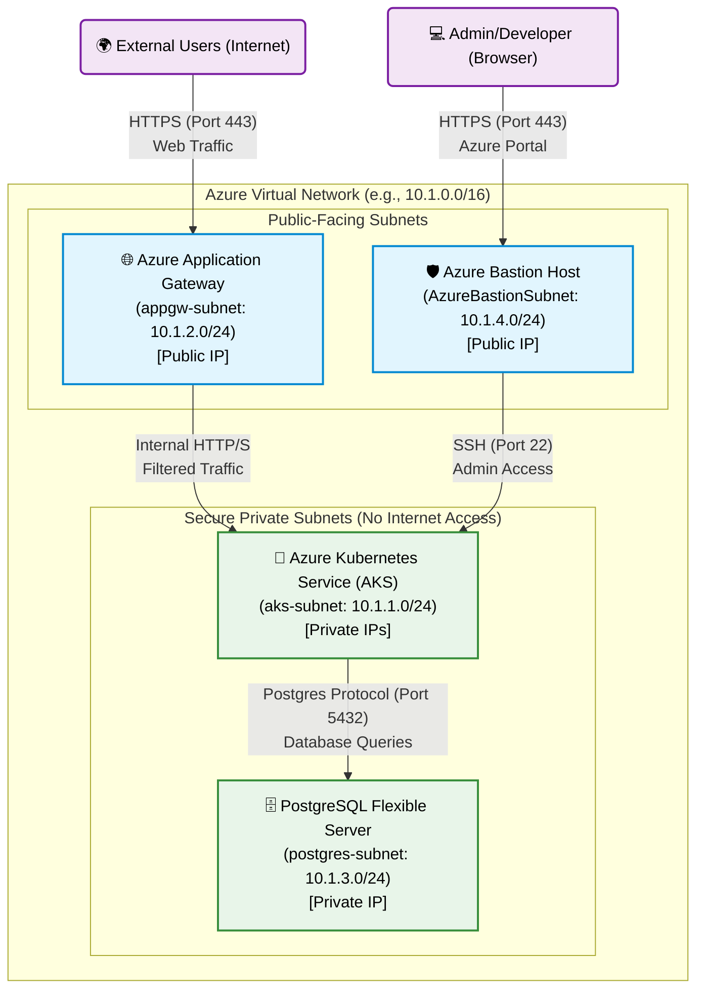
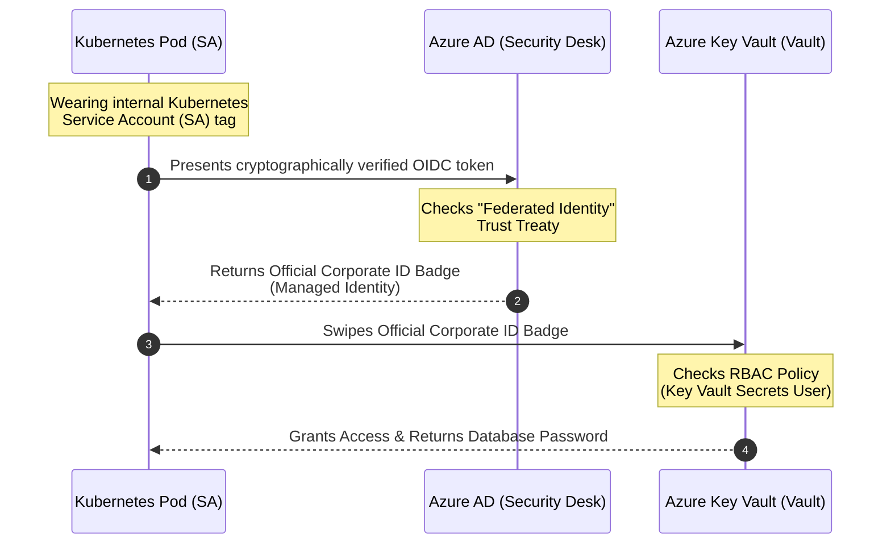
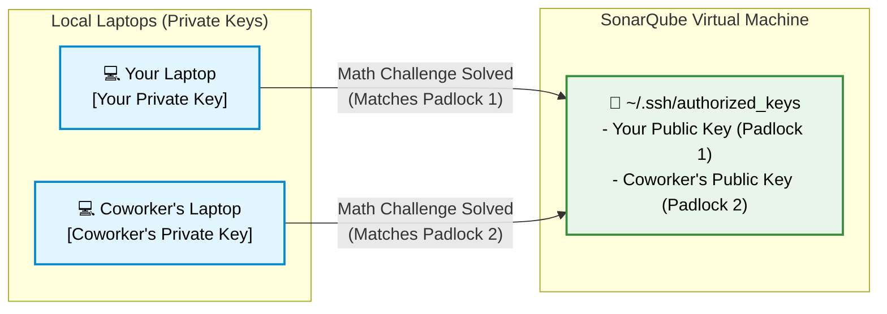

# Boutique Deployment Runbook

This guide outlines the steps required to completely tear down and rebuild the Boutique application infrastructure and GitOps deployments from scratch. All previous manual workarounds have been automated within the codebase, meaning you no longer need to run any manual Azure CLI commands during provisioning.

## 1. Complete Teardown (Destroy)

If you have an existing deployment, you should run the destroy pipeline to clean up Azure resources.

1. Navigate to **Azure DevOps > Pipelines**.
2. Run the **Destroy Infrastructure** pipeline.
   - It will run a `terraform plan -destroy`.
   - Once it pauses for manual intervention, review the plan and click **Resume** to approve the actual `terraform apply -destroy`.

## 2. Infrastructure Provisioning

Once the environment is clean, you can recreate the infrastructure.

1. Navigate to **Azure DevOps > Pipelines**.
2. Run the **Boutique Infrastructure Pipeline**.
   - This pipeline provisions the AKS cluster, Azure Key Vault, PostgreSQL Flexible Server, and Application Gateway.
   - **Automated Enhancements:** 
     - The Terraform script now automatically grants itself Key Vault access and provisions the `boutique-db-secret` (with your secure database credentials).
     - It no longer requires you to manually inject the secret via the Azure CLI.

## 3. GitOps Synchronization (Argo CD)

After the infrastructure finishes provisioning, Argo CD handles the cluster configuration and application deployments.

1. The infrastructure pipeline automatically deployed Argo CD and connected it to your `boutique-gitops` repository.
2. In the Argo CD dashboard, verify that the `system-apps` Application is syncing correctly.
   - **Automated Enhancements:**
     - The External Secrets Operator now securely authenticates using **ManagedIdentity** instead of WorkloadIdentity. You do not need to hardcode or update Azure Client IDs in the YAML manifests anymore.
     - The connection strings for the microservices are securely constructed using ExternalSecrets templating, so special characters in your database password (like `@` or `#`) are automatically URL-encoded and won't crash the Node.js applications.
3. Wait for the `system-apps` to turn Green (Healthy).
4. Argo CD will then deploy the `boutique-azure-dev` Application containing your microservices.
5. All pods (including `product-service`, `auth`, `orders`, and `gateway`) should start successfully and connect to the database.

## Troubleshooting

- **Database Connection Issues:** If pods fail to start, check the `boutique-secrets` Kubernetes secret in the `boutique-app` namespace to verify that the templating engine successfully generated the `DATABASE_URL`s.
- **Key Vault Access:** If External Secrets fail to sync, ensure the `aks_principal_id` (the AKS Kubelet Identity) was correctly assigned the `Get` and `List` Key Vault Access Policy in Terraform.

## Network Architecture

This diagram illustrates how your Virtual Network (VNet) is divided into public-facing and private subnets, and how Azure Bastion and the Application Gateway secure your backend infrastructure.

### 1. The "Public-Facing" Subnets (The Front Door)
These subnets are designed to receive traffic from the outside internet. They act as a secure gateway, preventing direct access to your application servers.
* **`appgw-subnet` (Application Gateway):** This subnet holds the Azure Application Gateway. The App Gateway gets a Public IP address and acts as your web firewall and load balancer. It accepts HTTP/HTTPS traffic from your users, filters out malicious requests, and forwards the safe traffic back to your Kubernetes cluster.
* **`AzureBastionSubnet`:** This subnet holds Azure Bastion, which also gets a Public IP. If you ever need to SSH into a node or VM for debugging, you log in through Bastion in your browser. It allows you to securely access your infrastructure without opening SSH port 22 to the public internet.

### 2. The "Private" Subnets (The Secure Backend)
These subnets have **no public IP addresses** and cannot be reached directly from the internet. They can only be accessed by resources already inside the VNet (like your App Gateway or Bastion).
* **`aks-subnet` (Kubernetes):** This is where your actual microservices run. Because they are on a private subnet, a hacker cannot directly attack your pods or nodes from the internet. The only way external users can reach your apps is by going through the Application Gateway first.
* **`postgres-subnet` (Database):** This subnet is dedicated entirely to your PostgreSQL Flexible Server. It is fully isolated and locked down. The only resources allowed to talk to the database are the microservices running in the `aks-subnet`. This ensures your most critical asset (customer data) is buried deep inside the private network.

## Federated Identity & Secret Management

To pull secrets (like the database password) out of Azure Key Vault without hardcoding any passwords in Kubernetes, we use **Workload Identity (OIDC)** and **Federated Identity Credentials**. 

The easiest way to understand this is to imagine Azure as a **Main Corporate Office Building** and Kubernetes (AKS) as a **Specific Department** inside that building.

### The Identity Flow Diagram

### Concept Breakdown

1. **Service Account (SA)**: Kubernetes issues its own internal **Department Name Tags** to the pods (applications). We created a tag called `external-secrets`. Azure Key Vault does not recognize this tag on its own.
2. **Managed Identity (`azurerm_user_assigned_identity`)**: Think of this as an **Official Corporate ID Badge** for a robot. We told Azure to print a brand new badge called `bq-dev-app-identity`.
3. **RBAC Role**: This is the **job title** assigned to the Official Corporate ID Badge. We gave it the title *"Key Vault Secrets User"*. 
4. **Federated Identity Credential (OIDC)**: This is the **Trust Treaty** we signed between Kubernetes and Azure. It tells Azure Active Directory: *"If a pod shows up wearing the internal `external-secrets` name tag, trust it. Temporarily hand it the Official Corporate ID Badge (`bq-dev-app-identity`)."*

Because of this setup, the pod can dynamically check out a valid Azure identity, unlock the Key Vault, and pull your database passwords—all instantly, securely, and completely password-free!

## Virtual Machine Access (SSH Public-Key Cryptography)

Unlike PaaS services (like Key Vault or ACR) where Azure manages the servers, IaaS services (like the SonarQube Virtual Machine) require you to manage the underlying Linux operating system. To do this securely, we use **SSH Public-Key Cryptography** instead of passwords.

### How it works (The Padlock and Key)

When Terraform provisions the VM, it bakes your **Public Key** (the "padlock") into a hidden file on the server called `~/.ssh/authorized_keys`. Your **Private Key** (the "metal key") never leaves your laptop. When you connect, the VM gives your laptop a complex math problem. Only your secret Private Key can solve it, proving your identity instantly.

### Adding Access for a Coworker

If a coworker needs access to the VM, you should **never** share your Private Key with them. Instead, you add their "padlock" to the door alongside yours:

1. **They Generate Keys:** Your coworker runs `ssh-keygen` on their laptop to generate their own Private and Public keys.
2. **They Share the Public Key:** They send you their Public Key (the `.pub` file contents). It is perfectly safe to share this over chat or email.
3. **You Update the Server:** You SSH into the SonarQube VM and paste their Public Key on a new line inside the `~/.ssh/authorized_keys` file.

Now the VM has two padlocks. When your coworker connects, the server verifies their Private Key against their specific padlock and lets them in. If they leave the company, you simply delete their line from the `authorized_keys` file to instantly revoke their access without affecting yours!
