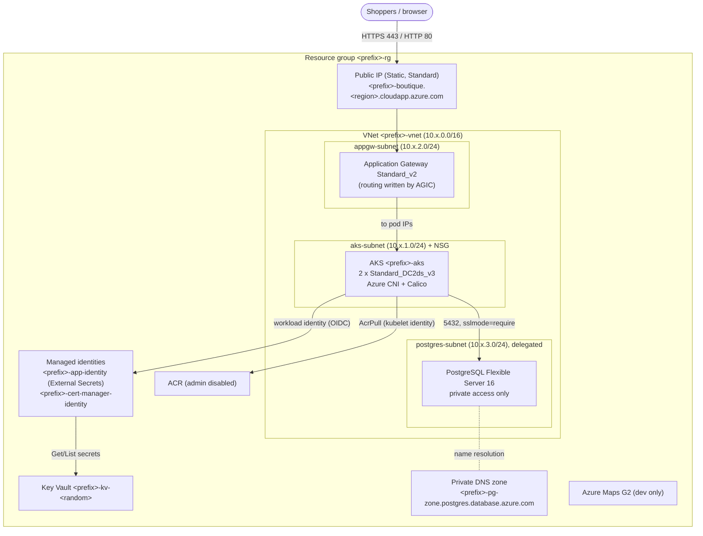
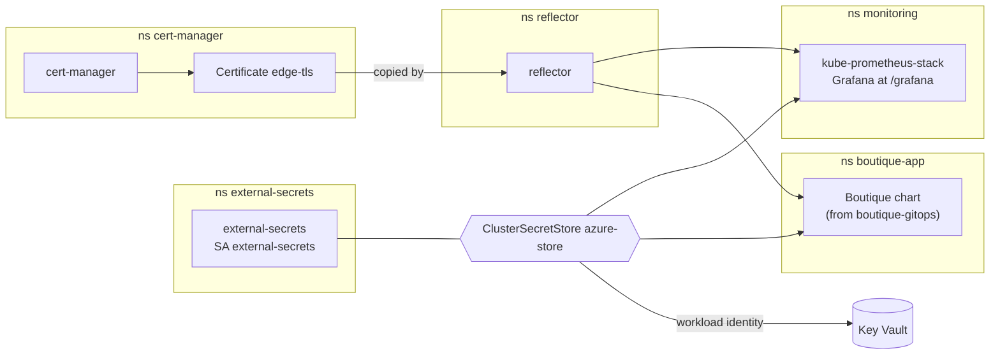
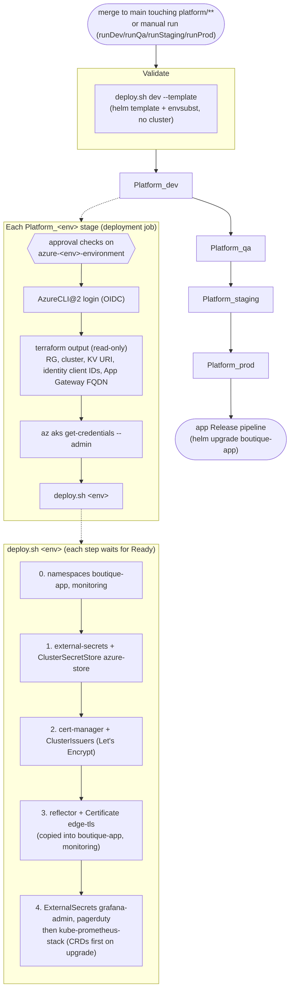
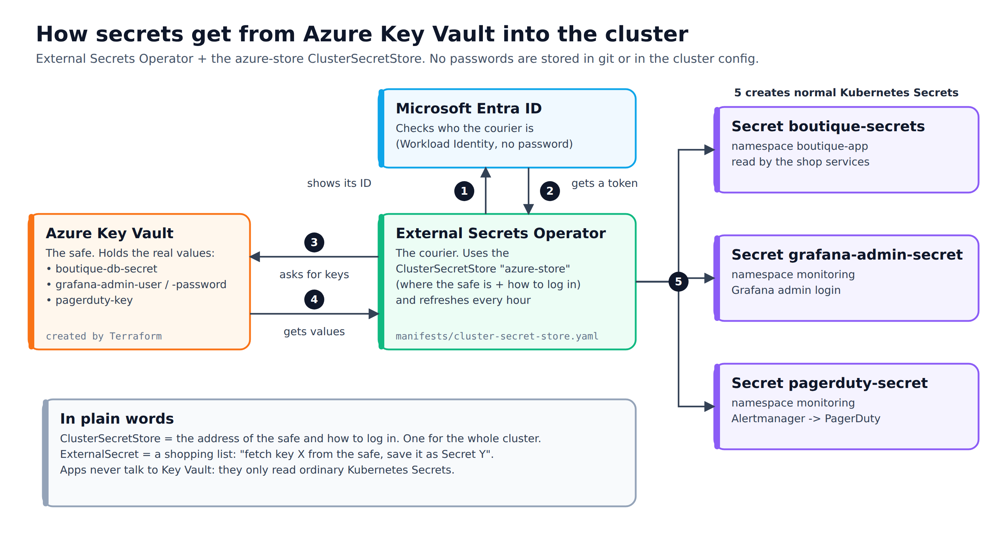
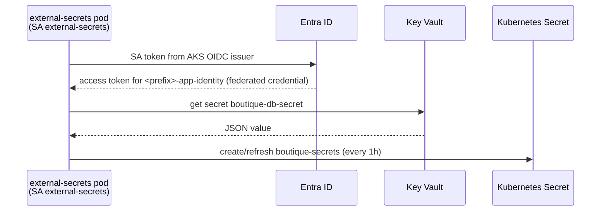
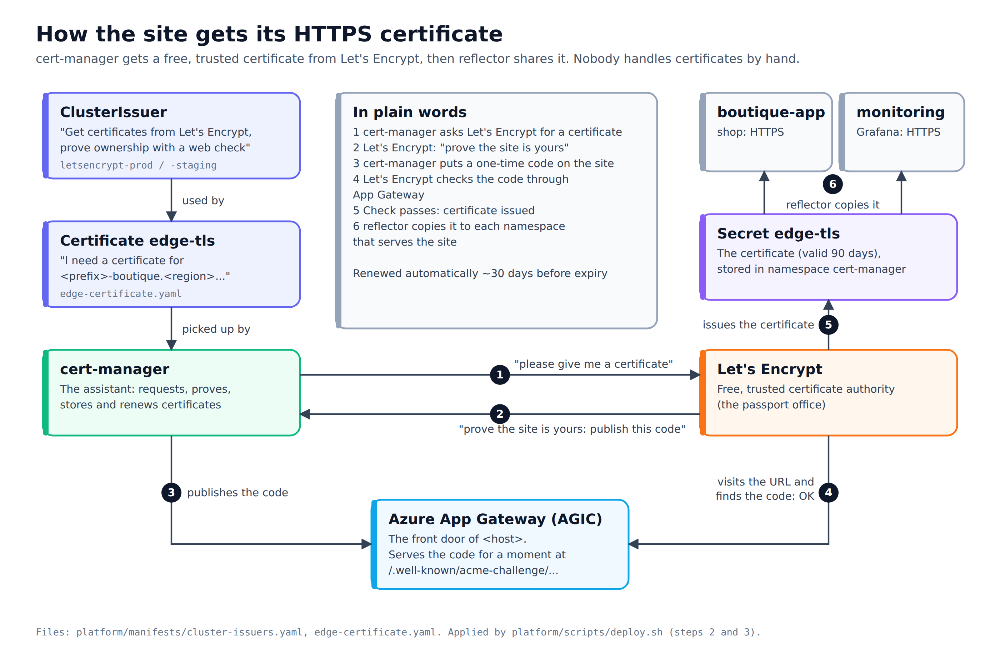

# boutique-infra

**The Azure infrastructure for the Boutique shop, as Terraform code, plus the cluster add-ons
(the "platform layer") installed on top with Helm.** Azure DevOps pipelines apply both; nothing
should be created by clicking in the Azure portal.

The Boutique shop is a set of microservices running on Azure Kubernetes Service (AKS). This
repository creates the ground they run on: network, cluster, database, image registry, Key
Vault, identities and the public entry point. It then installs the shared cluster tooling the
application chart depends on (External Secrets, cert-manager, reflector, Prometheus/Grafana).

> Status: only **dev** is provisioned by default. QA, staging and prod are fully defined in code
> but opt-in at pipeline queue time.

---

## Contents

1. [How the three repositories fit together](#1-how-the-three-repositories-fit-together)
2. [Architecture](#2-architecture)
3. [What gets created, per environment](#3-what-gets-created-per-environment)
4. [How the environments differ](#4-how-the-environments-differ)
5. [Repository layout](#5-repository-layout)
6. [Terraform state and backend](#6-terraform-state-and-backend)
7. [The three pipelines](#7-the-three-pipelines)
8. [Azure DevOps prerequisites](#8-azure-devops-prerequisites)
9. [First-time bootstrap (running from scratch)](#9-first-time-bootstrap-running-from-scratch)
10. [Platform layer (what `platform/` installs)](#10-platform-layer-what-platform-installs)
11. [Secrets](#11-secrets)
12. [Identity and access](#12-identity-and-access)
13. [Day-2 tasks](#13-day-2-tasks)
14. [Destroy procedure (and its dangers)](#14-destroy-procedure-and-its-dangers)
15. [Cost notes](#15-cost-notes)
16. [Known gaps](#16-known-gaps)
17. [Troubleshooting](#17-troubleshooting)

---

## 1. How the three repositories fit together

| Repo | What it holds | Who applies it |
|---|---|---|
| **`boutique-infra`** (this) | Azure resources (Terraform) and the cluster platform layer (Helm) | `azure-pipelines-infra.yml`, then `azure-pipelines-platform.yml` |
| **`boutique-gitops`** | The Helm chart for the shop's workloads (`helm/boutique-app`) with `values-<env>.yaml` per environment | Azure DevOps **Release** pipelines, one per environment (`helm upgrade --install`) |
| **`boutique-app`** | Application source, and the CI pipeline (`azure-pipelines.yml`: CodeQuality -> Test -> BuildAndScan) | CI builds and scans images and pushes them (tag = commit SHA) to the **dev** ACR |

Per environment, the order is always: **infra pipeline -> platform pipeline -> app Release pipeline.**

```text
infra pipeline    (this repo) --terraform--> Azure: RG, VNet, AKS, ACR, Key Vault, App Gateway, Postgres, identities
platform pipeline (this repo) --helm-------> AKS: external-secrets + azure-store, cert-manager + ClusterIssuers,
                                                   reflector + edge-tls, kube-prometheus-stack
app CI            (boutique-app) --push----> dev ACR (image tag = commit SHA)  --deploy-info artifact-->
app Release       (boutique-gitops chart) --helm upgrade --install--> AKS namespace boutique-app
```

What the application chart in `boutique-gitops` expects from this repo:

| It needs | Provided by |
|---|---|
| `ClusterSecretStore` named **`azure-store`** | `platform/manifests/cluster-secret-store.yaml` (see [section 10](#the-azure-store-clustersecretstore)) |
| Key Vault secret **`boutique-db-secret`** (JSON) | Terraform, `azurerm_key_vault_secret.db_secret` in `azure/environments/<env>/main.tf` |
| CRDs `ExternalSecret`, `ServiceMonitor`, `PrometheusRule` | external-secrets and kube-prometheus-stack charts |
| TLS secret `edge-tls` in namespace `boutique-app` | cert-manager `Certificate` + reflector (platform layer) |
| Ingress class `azure/application-gateway` (AGIC) | AKS `ingress_application_gateway` add-on, Terraform |
| The environment's hostname for `ingress.host` | `terraform output -raw app_gateway_fqdn` |

> History: the platform layer used to be installed by Argo CD (GitOps sync). Commit `69ba000`
> ("replace ArgoCD with a Helm-based platform pipeline") removed Argo CD; nothing in this repo
> installs or references it any more.

## 2. Architecture

One environment (all four are identical in shape):



Inside the cluster:



## 3. What gets created, per environment

Each environment folder (`azure/environments/<env>/`) is its own Terraform root module with its
own state. Names are built from `prefix` in `<env>.tfvars`.

| Resource | Terraform | Name | Key settings |
|---|---|---|---|
| Resource group | `module.resource_group` | `<prefix>-rg` | |
| Virtual network | `module.network` | `<prefix>-vnet` | subnets `aks-subnet`, `appgw-subnet`, `postgres-subnet` (delegated to `Microsoft.DBforPostgreSQL/flexibleServers`) |
| NSG on AKS subnet | `module.network` | `<prefix>-vnet-aks-nsg` | one custom rule: `AllowAppGwToCertManager`, TCP 8089 from the App Gateway subnet (the cert-manager HTTP-01 solver port) |
| Public IP | `module.app_gateway` | `<prefix>-appgw-pip` | Static, Standard SKU, DNS label `<prefix>-boutique` -> `<prefix>-boutique.<region>.cloudapp.azure.com`; stable across rebuilds |
| Application Gateway | `module.app_gateway` | `<prefix>-appgw` | `Standard_v2`, fixed capacity 1, SSL policy `AppGwSslPolicy20220101`, no WAF. Created with placeholder listener/rule/pool; **AGIC owns routing** afterwards (see below) |
| AKS | `module.aks` | `<prefix>-aks` | `sku_tier = Free`; one node pool `default`, **2 x `Standard_DC2ds_v3`, autoscaling off**; system-assigned identity; OIDC issuer + workload identity enabled; AGIC add-on pointed at the App Gateway; `network_plugin = azure`, `network_policy = calico`; Linux admin `azureuser` with `ssh_public_key`. Kubernetes version is not pinned (Azure's default at creation time) |
| PostgreSQL Flexible Server | `module.postgres` | `<prefix>-pg` | version 16, `GP_Standard_D2ds_v5`, 32 GB storage, `public_network_access_enabled = false`, in the delegated subnet, admin user `postgres`. No HA, no custom backup settings (Azure defaults) |
| Private DNS zone + VNet link | `module.postgres` | `<prefix>-pg-zone.postgres.database.azure.com` | lets the cluster resolve the private server name |
| Key Vault | `module.keyvault` | `<prefix>-kv-<5 random chars>` | `standard` SKU, **access-policy model** (not RBAC), soft delete 7 days, purge protection **off** |
| Key Vault secrets | env `main.tf` | `boutique-db-secret`, `pagerduty-key` (+ `grafana-admin-user`, `grafana-admin-password` in dev only) | see [section 11](#11-secrets) |
| Container registry | `module.acr` | from the `acr-registries` variable group (`devAcr`, `qaAcr`, `stagingAcr`, `prodAcr`) | `admin_enabled = false`; SKU `Standard` (prod: `Premium`) |
| User-assigned identity + federated credential | `module.identity` | `<prefix>-app-identity`, `<prefix>-app-fic` | used by **External Secrets** (subject `system:serviceaccount:external-secrets:external-secrets`) |
| User-assigned identity + federated credential | `module.identity` | `<prefix>-cert-manager-identity`, `<prefix>-cert-manager-fic` | used by cert-manager (subject `system:serviceaccount:cert-manager:cert-manager`); no Azure roles yet (reserved for DNS-01) |
| Role assignments | `module.identity` | | AGIC identity: `Contributor` on the App Gateway, `Reader` on the RG, `Network Contributor` on the App Gateway subnet. Kubelet identity: `AcrPull` on this environment's ACR |
| Azure Maps account | `module.maps` (**dev only**) | `<prefix>-maps-dev` | SKU `G2`; its primary key is written into `boutique-db-secret` |
| Random values | env `main.tf` | `random_string.kv_suffix`, `random_password.internal_api_token` | Key Vault name suffix; 48-char service-to-service token |

AKS also creates its own node resource group (`MC_<rg>_<cluster>_<region>`), which holds the node
VMs and the managed disks for persistent volumes (e.g. Prometheus's 20Gi disk). Terraform does not
manage it directly; it goes away with the cluster.

**AGIC owns App Gateway's routing config.** The `app_gateway` module has
`lifecycle.ignore_changes` on listeners, rules, backend pools and settings, probes, redirects,
rewrites, URL path maps and SSL/trusted-root certificates, so `terraform apply` does not undo what
AGIC writes from the cluster's Ingress objects.

### Terraform outputs (every environment)

| Output | Used by |
|---|---|
| `resource_group_name`, `cluster_name` | platform pipeline (`az aks get-credentials`), humans |
| `keyvault_uri` | platform pipeline -> `KV_URL` for the `azure-store` ClusterSecretStore |
| `app_identity_client_id` | platform pipeline -> `ESO_CLIENT_ID` (External Secrets service account annotation) |
| `cert_manager_client_id` | platform pipeline -> `CERT_MANAGER_CLIENT_ID` |
| `app_gateway_fqdn` | platform pipeline -> `APP_HOST`; also `ingress.host` in `boutique-gitops/helm/boutique-app/values-<env>.yaml` |
| `app_gateway_public_ip` | information |
| `postgres_fqdn` | information (the app gets it from Key Vault) |
| `kube_config` (sensitive) | break-glass only |
| `azure_maps_primary_access_key` (sensitive, **dev only**) | information |

## 4. How the environments differ

| | dev | qa | staging | prod |
|---|---|---|---|---|
| `prefix` | `bq-dev` | `bq-qa` | `bq-staging` | `boutique-prod` |
| Region | UAE North | Central India | Central India | Central India |
| VNet | `10.1.0.0/16` | `10.3.0.0/16` | `10.4.0.0/16` | `10.2.0.0/16` |
| Subnets (aks / appgw / postgres) | `10.1.1.0/24` / `.2.0/24` / `.3.0/24` | `10.3.1-3.0/24` | `10.4.1-3.0/24` | `10.2.1-3.0/24` |
| State key | `dev2.terraform.tfstate` | `qa.terraform.tfstate` | `staging.terraform.tfstate` | `prod.terraform.tfstate` |
| Public hostname | `bq-dev-boutique.uaenorth.cloudapp.azure.com` | `bq-qa-boutique.centralindia.cloudapp.azure.com` | `bq-staging-boutique.centralindia.cloudapp.azure.com` | `boutique-prod-boutique.centralindia.cloudapp.azure.com` |
| ACR SKU | Standard | Standard | Standard | **Premium** |
| ACR name from | `devAcr` | `qaAcr` | `stagingAcr` | `prodAcr` |
| Azure Maps | **created by Terraform** | key from `TF_VAR_azure_maps_subscription_key` | same as qa | same as qa |
| Grafana admin secrets in Key Vault | **yes** | no (see [Known gaps](#16-known-gaps)) | no | no |
| `prevent_deletion_if_contains_resources` | false | false | **true** | **true** |
| `terraform_policy` has `ignore_changes = all` | yes | yes | yes | **no** |
| Allowed `location` values | includes UAE North | includes East US, not UAE North | same as qa | no Canada Central / UAE North |
| Default in pipelines | runs | opt-in | opt-in | opt-in (destroy: `runProdDestroy`) |

Everything else (AKS size, Postgres SKU, App Gateway SKU, Key Vault settings) is hard-coded in the
modules and is therefore **the same in every environment**, prod included.

Non-overlapping VNet ranges mean the environments could be peered later without renumbering.

## 5. Repository layout

```
boutique-infra/
├── azure/
│   ├── environments/            # one Terraform root module (and one state file) per environment
│   │   ├── dev/                 # main.tf, variables.tf, outputs.tf, providers.tf (backend), dev.tfvars
│   │   ├── qa/
│   │   ├── staging/
│   │   └── prod/
│   ├── modules/
│   │   ├── resource_group/      # the RG
│   │   ├── network/             # VNet, 3 subnets, AKS-subnet NSG + cert-manager solver rule
│   │   ├── app_gateway/         # public IP (DNS label) + App Gateway; ignores AGIC-managed config
│   │   ├── aks/                 # AKS with OIDC, workload identity, AGIC add-on
│   │   ├── postgres/            # Flexible Server + private DNS zone
│   │   ├── keyvault/            # Key Vault + kubelet-identity access policy
│   │   ├── acr/                 # Container Registry (admin disabled, RBAC only)
│   │   ├── identity/            # workload identities, federated credentials, RBAC, KV policy
│   │   └── maps/                # Azure Maps account (used by dev only)
│   └── templates/
│       ├── terraform-deploy.yml    # Plan + Apply stages for one environment
│       ├── terraform-destroy.yml   # Plan Destroy + Apply Destroy stages for one environment
│       └── platform-deploy.yml     # Deploy Platform stage for one environment
├── platform/
│   ├── versions.env             # pinned chart versions
│   ├── values/<chart>/values.yaml   # Helm values (add values-<env>.yaml for overrides)
│   ├── manifests/               # ClusterSecretStore, ClusterIssuers, edge-tls Certificate, ExternalSecrets
│   └── scripts/deploy.sh        # installs everything above, in order
├── azure-pipelines-infra.yml    # Terraform plan/apply
├── azure-pipelines-platform.yml # platform add-ons
├── azure-pipelines-destroy.yml  # Terraform destroy
└── .gitignore
```

Files worth knowing about:

- `.gitignore` excludes `*.tfvars`, yet the four `<env>.tfvars` files are tracked (they hold
  only non-secret values: location, prefix, CIDRs). A **new** tfvars file needs `git add -f`.
- `.terraform.lock.hcl` is gitignored, so the provider version floats within `azurerm ~> 3.0` on
  every pipeline run.
- `azure/environments/dev/dev.local.tfvars` may exist on a developer machine for local runs; it
  is gitignored and must never be committed. Create it with the variables in `variables.tf`
  (including `jwt_secret`, `admin_email`, `admin_initial_password`).

## 6. Terraform state and backend

All environments use the `azurerm` backend in the same storage account, one blob per environment:

| Setting | Value |
|---|---|
| Resource group | `tfstate-rg` |
| Storage account | `boutiquetfstate2026v2` |
| Container | `tfstate` |
| Key | `<env>.terraform.tfstate` (dev: `dev2.terraform.tfstate`) |

- The backend storage is **not created by this repo**. It must exist before the first run and it
  survives a destroy.
- Pipelines use Terraform `1.7.5` (`TerraformInstaller@1`) and `hashicorp/azurerm ~> 3.0`.
- Authentication is **OIDC (workload identity federation)** through the service connection: the
  pipeline exports `ARM_CLIENT_ID`, `ARM_TENANT_ID`, `ARM_SUBSCRIPTION_ID`, `ARM_USE_OIDC=true`
  and `ARM_OIDC_TOKEN` from the `AzureCLI@2` task (`addSpnToEnvironment: true`). No client secret
  is stored.
- Blob leases give state locking. If a run is cancelled mid-apply, the lease may need breaking
  (see [Troubleshooting](#17-troubleshooting)).
- Provider features set in every `providers.tf`: Key Vault `purge_soft_delete_on_destroy = true`
  and `recover_soft_deleted_key_vaults = true`; `prevent_deletion_if_contains_resources` as in the
  table above.

Running Terraform locally (read-only inspection, e.g. outputs):

```bash
az login
cd azure/environments/dev
terraform init
terraform output -raw app_gateway_fqdn
```

A local `plan`/`apply` needs every `TF_VAR_*` from [section 8](#pipeline-variables) set in your
shell. Prefer the pipeline; it is the only path with an approval gate.

## 7. The three pipelines

All three use Microsoft-hosted `ubuntu-latest` agents and the service connection
**`Azure Resource Group`**.

```
infra pipeline      Plan_<env> -> Apply_<env>          (per env)    azure-pipelines-infra.yml
platform pipeline   Validate -> Platform_<env>         (per env)    azure-pipelines-platform.yml
destroy pipeline    PlanDestroy_<env> -> ApplyDestroy_<env>          azure-pipelines-destroy.yml
app CI              CodeQuality -> Test -> BuildAndScan              boutique-app/azure-pipelines.yml
app Release         helm upgrade --install (per env)                 Azure DevOps Releases
```

### 7.1 Infra pipeline (`azure-pipelines-infra.yml`)

**Triggers:** `trigger: none`, so merging to `main` does **not** apply anything; run it by hand.
It declares a `pr:` trigger for `azure/environments/**`, `azure/modules/**`,
`azure/templates/terraform-*.yml` and itself, but this repo is on Azure Repos, which ignores the
YAML `pr:` block; PR plans only run if a **build validation branch policy** on `main` points at
this pipeline.

**Parameters:** `runDev` (default `true`), `runQa`, `runStaging`, `runProd` (default `false`).

**Stages per environment** (`azure/templates/terraform-deploy.yml`):

| Stage | Job | What it does |
|---|---|---|
| `Plan_<env>` | `TerraformPlan` | install Terraform 1.7.5; **Trivy** IaC scan of the env folder (`misconfig`, CRITICAL/HIGH, **non-blocking**: `exitCode: 0`); `terraform fmt -check` (non-blocking), `init`, `validate`, `plan -var-file=<env>.tfvars -out=...`; publishes the plan as artifact `<env>-tfplan` |
| `Apply_<env>` | deployment `TerraformApply`, environment **`azure-<env>-environment`** | downloads the saved plan and runs `terraform apply -auto-approve <plan>`, so what is applied is exactly what was planned. Skipped on PR builds |

**Ordering:** QA waits for `Apply_dev`, staging for `Apply_qa`, prod for `Apply_staging`, but
only when the earlier environment is in the same run. Set `runDev=false, runQa=true` to apply QA
on its own. On PR builds all plans run in parallel and nothing is applied.

**Selective runs:**

| Parameter | Controls |
|---|---|
| `runDev` | Plan/Apply `dev` |
| `runQa` | Plan/Apply `qa` |
| `runStaging` | Plan/Apply `staging` |
| `runProd` | Plan/Apply `prod` |

Image promotion to higher environments is **not** in this pipeline; it belongs to that
environment's app Release pipeline (see [Container registries](#container-registries)).

### 7.2 Platform pipeline (`azure-pipelines-platform.yml`)

**Triggers:** CI on `main` for changes under `platform/**`, `azure-pipelines-platform.yml` and
`azure/templates/platform-deploy.yml`, so **a merge that touches `platform/` deploys to dev
automatically** (subject to any checks on `azure-dev-environment`). The `pr:` block is ignored by
Azure Repos, as above; add a build validation policy to run `Validate` on PRs.

**Parameters:** `runDev` (default `true`), `runQa`, `runStaging`, `runProd` (default `false`).

| Stage | What it does |
|---|---|
| `Validate` | installs Helm `v3.15.4` and runs `platform/scripts/deploy.sh dev --template`: renders every chart and manifest with placeholder values, no cluster needed |
| `Platform_<env>` (deployment, environment `azure-<env>-environment`) | installs Terraform and Helm; `terraform init` + `terraform output` for the env (read-only); `az aks get-credentials --admin`; runs `platform/scripts/deploy.sh <env>`. Skipped on PR builds |



PR builds run only `Validate`; every `Platform_<env>` stage is skipped.

Environment ordering works as in the infra pipeline (`Platform_qa` waits for `Platform_dev` when
both run, and so on). Each stage waits only for the one directly before it, so skipping a middle
environment breaks the chain: `runDev=true, runStaging=true` (QA off) makes `Platform_staging`
depend on `Validate` and run in parallel with `Platform_dev`, not after it. The approval checks on
`azure-staging-environment` still apply. The ACME account email is the `acmeEmail` variable in the
pipeline YAML; the issuer used for `edge-tls` is the template parameter `clusterIssuer` (default
`letsencrypt-prod`).

### 7.3 Destroy pipeline (`azure-pipelines-destroy.yml`)

**Triggers:** `trigger: none`; manual only.

**Parameters:** `runDev`, `runQa`, `runStaging`, `runProdDestroy` ("Destroy Prod (danger)"),
**all default `false`**. Nothing is destroyed unless you tick a box.

| Stage | What it does |
|---|---|
| `PlanDestroy_<env>` | `terraform init` + `terraform plan -destroy -var-file=<env>.tfvars` (printed in the log, **not saved**) |
| `ApplyDestroy_<env>` (deployment, environment `azure-<env>-environment`) | `terraform destroy -auto-approve -var-file=<env>.tfvars` |

Unlike the other two, **destroy stages do not depend on each other**: tick several environments
and they run in parallel. Read [section 14](#14-destroy-procedure-and-its-dangers) before using it.

### Order to run them

| Situation | Run |
|---|---|
| New environment | infra -> platform -> app CI (if the images are not in ACR) -> app Release |
| Terraform change | infra (for the affected environments) |
| Chart version or values change in `platform/` | platform (dev runs automatically on merge) |
| New app version | app CI -> app Release |
| Tear down | destroy (the app and platform go with the cluster) |

## 8. Azure DevOps prerequisites

### Service connection

`Azure Resource Group`, an Azure Resource Manager connection using **workload identity
federation** (the templates read `$idToken`). From what Terraform creates, its identity needs, at
subscription scope, rights to create resource groups and all resources above **and to create role
assignments** (for example Owner, or Contributor plus User Access Administrator), plus access to the
`tfstate-rg` storage account. The platform stage also calls `az aks get-credentials --admin`.
The exact role currently assigned is configured in Azure, not in this repo.

### Environments

| Environment name | Used by | Approval |
|---|---|---|
| `azure-dev-environment` | Apply, Platform, Apply Destroy for dev | none (intended) |
| `azure-qa-environment` | same, qa | optional |
| `azure-staging-environment` | same, staging | optional |
| `azure-prod-environment` | same, prod | **required** |

Approvals and checks are configured in Azure DevOps (Pipelines -> Environments -> *env* ->
Approvals and checks), not in YAML. The same environment gates infra apply, platform deploy **and
destroy**, so an environment without an approval check is destroyed as soon as its plan finishes.

### Variable group

`acr-registries` (Pipelines -> Library) provides `devAcr`, `qaAcr`, `stagingAcr`, `prodAcr`. It
is used by the infra and destroy pipelines (as `TF_VAR_acr_name`) and by `boutique-app` CI.

### Pipeline variables

Set these on **both the infra and the destroy pipeline** (destroy needs them too, because
`terraform plan -destroy` evaluates every variable and its validation). Mark the sensitive ones as
**secret**; the templates map each one into the Terraform step's environment explicitly.

| Variable | Description | Secret | Environments |
|---|---|---|---|
| `TF_VAR_db_password` | PostgreSQL admin password (at least 8 characters) | yes | all |
| `TF_VAR_jwt_secret` | Token signing secret (`openssl rand -hex 32`), unique per environment | yes | all |
| `TF_VAR_admin_email` | Store owner's email; the auth service creates this admin on first start (validated as an email address) | yes | all |
| `TF_VAR_admin_initial_password` | Store admin's first password (at least 12 characters); forced to change at first sign-in | yes | all |
| `TF_VAR_pagerduty_key` | PagerDuty integration (routing) key for Alertmanager | yes | all |
| `TF_VAR_ssh_public_key` | SSH public key for the AKS node admin user | no | all |
| `TF_VAR_cloudinary_cloud_name` | Cloudinary cloud name | yes | all |
| `TF_VAR_cloudinary_api_key` | Cloudinary API key | yes | all |
| `TF_VAR_cloudinary_api_secret` | Cloudinary API secret | yes | all |
| `TF_VAR_google_client_id` | Google OAuth client ID | yes | all |
| `TF_VAR_razorpay_key_id` | Razorpay key ID (`rzp_live_…` in prod) | yes | all |
| `TF_VAR_razorpay_key_secret` | Razorpay key secret | yes | all |
| `TF_VAR_grafana_admin_password` | Grafana admin password | yes | dev (declared only there) |
| `TF_VAR_grafana_admin_user` | Grafana admin user; Terraform default is `admin` | no | dev (declared only there) |
| `TF_VAR_azure_maps_subscription_key` | Azure Maps key | yes | **qa, staging, prod** (dev creates its own Maps account) |

`TF_VAR_acr_name` is set by the templates from the `acr-registries` group; do not create it.

Pipeline variables are shared by every environment the pipeline runs. To give qa/prod different
values (they should, e.g. `jwt_secret` and Razorpay live keys), use separate runs with different
queue-time values, or move the values into per-environment variable groups; the repo does not do
this yet.

**Define every variable in the table, even "optional" ones.** The templates reference them with
`$(TF_VAR_x)` macro syntax; if a variable is not defined, Azure DevOps leaves the literal text
`$(TF_VAR_x)` in the environment, and Terraform uses that string as the value (e.g. as the Grafana
admin user name) instead of the default.

## 9. First-time bootstrap (running from scratch)

### Step 0 - One-time prerequisites (outside Terraform, survive a destroy)

- Storage account `boutiquetfstate2026v2` with container `tfstate` in resource group `tfstate-rg`.
- Service connection, environments, the `acr-registries` variable group and the pipeline variables
  from [section 8](#8-azure-devops-prerequisites). The ACR names in the group must be globally
  unique and 5-50 alphanumeric characters.
- The three pipelines created in Azure DevOps from the three YAML files.

### Step 1 - Infrastructure

Run the **infra pipeline**. By default it plans and applies **dev** only; review the plan and
approve the Apply stage in `azure-dev-environment` if it has a check.

### Step 2 - Environments beyond dev

Tick `runQa`, `runStaging` or `runProd` at queue time. Each environment waits for the previous
one when both are in the same run. Before QA/staging/prod, fix the Grafana gap in
[section 16](#16-known-gaps), or the platform step will fail there.

### Step 3 - Platform add-ons

Run the **platform pipeline** for the environment (dev runs automatically when `platform/**`
changes on `main`). It reads the environment's Terraform outputs and runs
`platform/scripts/deploy.sh`; see [section 10](#10-platform-layer-what-platform-installs). The
first run on a new cluster includes the first Let's Encrypt issuance, which can take several
minutes while AGIC programs App Gateway for the HTTP-01 challenge.

### Step 4 - Images

Each environment's ACR is empty after a (re)build. Run `boutique-app` CI on `main` to push images
to the dev ACR; for higher environments the Release pipeline imports the tested tag (see below).

### Step 5 - Application

Run the app's Release pipeline. The app chart needs the CRDs, `ClusterSecretStore` and
`ClusterIssuer`s from Step 3, so Step 3 must have completed first. Put the environment's
`app_gateway_fqdn` in `ingress.host` of `boutique-gitops/helm/boutique-app/values-<env>.yaml`
(it is stable across rebuilds, so this is a one-time edit).

### Step 6 - Store admin (first time only)

The auth service creates the admin from `TF_VAR_admin_email` / `TF_VAR_admin_initial_password` on first
start. Give both to the owner; the site forces a new password at first sign-in. The admin is only created
once, so changing the variables later does not change an existing account.

### Step 7 - Check it

```bash
az aks get-credentials -g bq-dev-rg -n bq-dev-aks
kubectl get clustersecretstore azure-store          # READY True
kubectl get clusterissuer                           # letsencrypt-staging, letsencrypt-prod Ready
kubectl get certificate -n cert-manager edge-tls    # Ready True
kubectl get externalsecret -A                       # all SecretSynced
kubectl get pods -n boutique-app
```

Then open `https://<app_gateway_fqdn>/` and `https://<app_gateway_fqdn>/grafana`.

### Container registries

Each environment has its own ACR, created by its Terraform (`module "acr"`), and its AKS kubelet
identity has `AcrPull` on that registry only. The registry names come from the `acr-registries`
variable group (`devAcr`, `qaAcr`, `stagingAcr`, `prodAcr`).

CI currently pushes to the dev ACR only. Moving an image to a higher environment is part of
that environment's app Release pipeline (`az acr import` of the already-tested tag: images are
promoted, never rebuilt), not of the infrastructure pipeline. The Release pipelines are configured
in Azure DevOps, not in any of the three repos.

## 10. Platform layer (what `platform/` installs)

`platform/scripts/deploy.sh <env>` installs into the current kubectl context, in this order, and
waits for each step:

| # | Chart (`platform/versions.env`) | Namespace | Then applies | Waits for |
|---|---|---|---|---|
| 0 | | | namespaces `boutique-app`, `monitoring` (so `edge-tls` can be copied in before workloads exist) | |
| 1 | `external-secrets` `0.10.4` (charts.external-secrets.io) | `external-secrets` | `manifests/cluster-secret-store.yaml` | `clustersecretstore/azure-store` Ready (3 min) |
| 2 | `cert-manager` `v1.16.1` (charts.jetstack.io) | `cert-manager` | `manifests/cluster-issuers.yaml` | both ClusterIssuers Ready (3 min) |
| 3 | `reflector` `10.0.65` (emberstack) | `reflector` | `manifests/edge-certificate.yaml` | `certificate/edge-tls` Ready (15 min, prints ACME state on failure), then the secret in each target namespace |
| 4 | `kube-prometheus-stack` `56.6.2` (prometheus-community) | `monitoring` | first `externalsecret-grafana-admin.yaml`, `externalsecret-pagerduty.yaml` | both ExternalSecrets Ready (3 min); on upgrade, applies the chart's CRDs server-side first (Helm never upgrades CRDs) |

Every `helm upgrade --install` uses `--wait --timeout 10m`. Manifests are rendered with
`envsubst` and applied with up to 10 retries (webhooks can take a moment to serve).

Values: `platform/values/<chart>/values.yaml`, plus `values-<env>.yaml` next to it if present
(none exist today). Environment-specific values (workload identity client IDs, the Grafana host)
are generated at run time from Terraform outputs.

### The `azure-store` ClusterSecretStore

Defined in **`platform/manifests/cluster-secret-store.yaml`** and applied by step 1 of `deploy.sh`:



In short: the **ClusterSecretStore** says where the safe (Key Vault) is and how to log in to it, for
the whole cluster. Each **ExternalSecret** is a shopping list ("fetch key X, save it as Secret Y").
External Secrets does the fetching every hour; apps only ever read ordinary Kubernetes Secrets.

```yaml
apiVersion: external-secrets.io/v1beta1
kind: ClusterSecretStore
metadata:
  name: azure-store
spec:
  provider:
    azurekv:
      authType: WorkloadIdentity
      tenantId: "${TENANT_ID}"      # service connection tenant
      vaultUrl: "${KV_URL}"         # terraform output keyvault_uri
      serviceAccountRef:
        name: external-secrets
        namespace: external-secrets
```

How it authenticates, end to end:

1. Terraform creates the user-assigned identity `<prefix>-app-identity` and a federated credential
   trusting the AKS OIDC issuer for subject `system:serviceaccount:external-secrets:external-secrets`
   (`modules/identity`).
2. Terraform gives that identity a Key Vault access policy with secret `Get` and `List`.
3. `deploy.sh` installs external-secrets with the service account annotation
   `azure.workload.identity/client-id: <app_identity_client_id>` and the pod label
   `azure.workload.identity/use: "true"` (`values/external-secrets/values.yaml`).
4. The ClusterSecretStore points at that service account, so External Secrets exchanges the
   service account's token for an Entra ID token and reads Key Vault. No password or client secret
   is involved.

Despite its name, `app-identity` is used by **External Secrets**, not by application pods. The
application never talks to Key Vault; it reads the Kubernetes Secret `boutique-secrets` that the
gitops chart's ExternalSecret creates from `boutique-db-secret`.



### Public endpoints and TLS



The **ClusterIssuers** (`letsencrypt-prod`, `letsencrypt-staging`) tell cert-manager to get
certificates from Let's Encrypt and to prove ownership with an HTTP-01 check: Let's Encrypt fetches a
one-time code from `http://<host>/.well-known/acme-challenge/...` through App Gateway. Use
`letsencrypt-staging` while testing: it has generous rate limits, but browsers don't trust its
certificates.

Let's Encrypt certificates last 90 days; cert-manager renews `edge-tls` automatically about 30
days before expiry.


Each environment has one stable hostname, `<prefix>-boutique.<region>.cloudapp.azure.com`
(`terraform output app_gateway_fqdn`), served by App Gateway through AGIC:

| URL | Backend | Exposure |
|---|---|---|
| `https://<host>/` and `/api` | boutique frontend / gateway (gitops chart) | public |
| `https://<host>/grafana` | Grafana (admin login from Key Vault) | public, login required |
| Prometheus, Alertmanager | ClusterIP only | `kubectl port-forward` |

- **One certificate per environment.** `edge-tls` (ECDSA P-256) is issued once by cert-manager
  (HTTP-01 via AGIC, ingress class `azure/application-gateway`) and copied by reflector into every
  namespace with an Ingress on that host (`boutique-app`, `monitoring`), so a rebuild costs one
  Let's Encrypt issuance (limit: 5 per week for the same hostname). Renewal is automatic.
- **HTTP->HTTPS redirect happens in the frontend's nginx** (`X-Forwarded-Proto` + HSTS), not with
  AGIC's `ssl-redirect`, which would also redirect the HTTP-01 challenge and break renewals.
- **AGIC owns App Gateway's routing config** (see [section 3](#3-what-gets-created-per-environment)).
- With a real domain, the standard upgrade is an Azure DNS zone plus DNS-01 validation (cert-manager
  already has a workload identity for it; it would need a DNS role), a wildcard certificate, and a
  separate `grafana.<domain>`.

### Monitoring settings

- Grafana: served from `/grafana`, admin from the `grafana-admin-secret` ExternalSecret
  (`grafana-admin-user` / `grafana-admin-password` in Key Vault), no persistent volume (dashboards
  and datasources are provisioned from ConfigMaps/Secrets, several of them by the gitops chart).
- Prometheus: 7 days / 15 GB retention on a 20Gi `managed-csi` volume.
- Alertmanager: routes to PagerDuty using the key mounted from `pagerduty-secret`
  (`pagerduty-key` in Key Vault); `severity = none` goes to a null receiver.
- Every environment has its own Prometheus, Alertmanager and Grafana. `deploy.sh` sets the
  Prometheus external label `environment=<env>`, so every alert carries it: PagerDuty incidents
  read `[DEV] HighErrorRate (boutique-app)`, with the environment in the details, and the
  PagerDuty severity follows the alert's (`critical`, otherwise `warning`).
- Paging policy lives in PagerDuty, not here: each environment's Key Vault holds its own
  `pagerduty-key`, so give each environment its own PagerDuty service. Make prod high-urgency (pages
  the on-call) and dev/qa/staging low-urgency (no phone call).
- Environment-specific overrides (e.g. longer retention in prod) go in
  `platform/values/kube-prometheus-stack/values-<env>.yaml`; none exist yet.

### Running it by hand

```bash
# against the current kubectl context; values come from `terraform output`
TENANT_ID=... KV_URL=... ESO_CLIENT_ID=... CERT_MANAGER_CLIENT_ID=... APP_HOST=... ACME_EMAIL=... \
  platform/scripts/deploy.sh dev
platform/scripts/deploy.sh dev --template   # render only, no cluster needed
```

Optional: `CLUSTER_ISSUER` (default `letsencrypt-prod`; use `letsencrypt-staging` while testing to
spare the rate limit) and `EDGE_TLS_NAMESPACES` (default `boutique-app,monitoring`).

## 11. Secrets

Names only; values live in pipeline variables and Key Vault.

### Key Vault secrets (created by Terraform)

| Key Vault secret | Contents | Read by |
|---|---|---|
| `boutique-db-secret` | JSON with the keys below | gitops chart ExternalSecret `boutique-secrets` (all services) and the chart's Grafana datasource ExternalSecret, via `azure-store` |
| `pagerduty-key` | `TF_VAR_pagerduty_key` | platform ExternalSecret `pagerduty-secret` -> Alertmanager |
| `grafana-admin-user`, `grafana-admin-password` (**dev only**) | `TF_VAR_grafana_admin_*` | platform ExternalSecret `grafana-admin-secret` -> Grafana |

Keys inside `boutique-db-secret`:

| Key | Source |
|---|---|
| `POSTGRES_HOST` | Postgres server FQDN (Terraform) |
| `POSTGRES_DB`, `POSTGRES_USER` | fixed: `postgres` |
| `POSTGRES_PASSWORD` | `TF_VAR_db_password` |
| `CLOUDINARY_CLOUD_NAME`, `CLOUDINARY_API_KEY`, `CLOUDINARY_API_SECRET` | pipeline variables |
| `GOOGLE_CLIENT_ID` | pipeline variable |
| `AZURE_MAPS_SUBSCRIPTION_KEY` | dev: the Maps account Terraform creates; qa/staging/prod: `TF_VAR_azure_maps_subscription_key` |
| `RAZORPAY_KEY_ID`, `RAZORPAY_KEY_SECRET` | pipeline variables |
| `JWT_SECRET` | `TF_VAR_jwt_secret` |
| `INTERNAL_API_TOKEN` | **generated** (`random_password.internal_api_token`), service-to-service auth; do not create a pipeline variable |
| `ADMIN_EMAIL`, `ADMIN_INITIAL_PASSWORD` | `TF_VAR_admin_email`, `TF_VAR_admin_initial_password` |

### Who can read Key Vault (access policies)

| Principal | Permissions | Defined in |
|---|---|---|
| Pipeline identity (service connection), `terraform_policy` | secrets: Get, List, Set, Delete, Recover, Backup, Restore, Purge | env `main.tf` |
| `<prefix>-app-identity` (External Secrets) | secrets: Get, List | `modules/identity` |
| AKS kubelet identity | secrets: Get, List | `modules/keyvault` |

Every value Terraform writes to Key Vault is also stored in the Terraform state blob in plain text.
Treat access to `boutiquetfstate2026v2` as access to every secret.

## 12. Identity and access

| Identity | Kind | Used for |
|---|---|---|
| Service connection `Azure Resource Group` | Entra app / managed identity with a federated credential for Azure DevOps | Terraform, `az aks get-credentials` |
| AKS cluster identity | system-assigned | the cluster control plane |
| AKS kubelet identity | created by AKS | pulling images (`AcrPull`); also has Key Vault Get/List |
| AGIC identity | created by the AKS add-on | writing App Gateway config (`Contributor` on the gateway, `Reader` on the RG, `Network Contributor` on its subnet) |
| `<prefix>-app-identity` | user-assigned, workload identity | External Secrets -> Key Vault |
| `<prefix>-cert-manager-identity` | user-assigned, workload identity | cert-manager; no role assignments today (reserved for DNS-01) |

Security properties that hold in code:

- **ACR admin account disabled**; all image access is RBAC (`AcrPull` via the kubelet identity).
- **Per-environment registries**: prod's kubelet identity has `AcrPull` on the prod ACR only
  (`coalesce(prod_acr_id, shared_acr_id)` in `modules/identity`; each non-prod env passes its own
  ACR as `shared_acr_id`, a leftover name from when non-prod shared one registry).
- **Postgres has no public endpoint** (`public_network_access_enabled = false`), reachable only
  inside the VNet.
- **No client secrets**: Terraform uses OIDC; in-cluster Azure access uses workload identity.
- AKS nodes have no public IPs and there is **no Bastion** or jump host (removed in `aa6a517`
  because no VM ever existed). There is no SSH path to the nodes from outside; use
  `kubectl debug node/...` if you need a node shell.

## 13. Day-2 tasks

### Get cluster access

```bash
az aks get-credentials -g <prefix>-rg -n <prefix>-aks     # e.g. bq-dev-rg / bq-dev-aks
kubectl port-forward -n monitoring svc/kube-prometheus-stack-prometheus 9090:9090
kubectl port-forward -n monitoring svc/kube-prometheus-stack-alertmanager 9093:9093
```

Grafana's admin login is in Key Vault (`grafana-admin-user` / `grafana-admin-password`) and in the
`monitoring/grafana-admin-secret` Secret.

### Scale the cluster or change sizes

Node count (`2`), VM size (`Standard_DC2ds_v3`), autoscaling (off), the Postgres SKU and the App
Gateway capacity (`1`) are **hard-coded in the modules**, so a change applies to every environment
at its next infra run. To size prod differently, turn the value into a module variable and set it
per environment. Changing the node pool VM size may force replacement of the default node pool or
the cluster; read the plan carefully.

### Add a secret for the application

1. Add a variable in `azure/environments/<env>/variables.tf` (all four environments) and the new key
   to the `jsonencode({...})` of `boutique-db-secret` in each `main.tf`.
2. Map `TF_VAR_<name>: $(TF_VAR_<name>)` in both `env:` blocks of `terraform-deploy.yml` and
   both `env:` blocks of `terraform-destroy.yml`, and create the pipeline variable (secret) on the infra and
   destroy pipelines.
3. Add the key to the ExternalSecret template in
   `boutique-gitops/helm/boutique-app/templates/database/external-secret.yml` (it lists keys
   explicitly) and consume it in the service.
4. Run the infra pipeline, then the app Release.

### Rotate a secret

- **Pipeline-sourced values** (`db_password`, `jwt_secret`, API keys, `pagerduty_key`, Grafana
  password): change the pipeline variable, run the infra pipeline. For `db_password` the same apply
  changes the Postgres admin password and the Key Vault value.
- **`INTERNAL_API_TOKEN`**: run `terraform apply -replace=random_password.internal_api_token`
  (locally, with all `TF_VAR_*` set); the pipeline has no replace option.
- External Secrets refreshes every **1 hour**. To pick up a change now:
  `kubectl annotate externalsecret -n boutique-app boutique-secrets force-sync=$(date +%s) --overwrite`,
  then restart the deployments that read it (`kubectl rollout restart deploy -n boutique-app`).
  During a `db_password` rotation the app cannot connect until it has the new value.
- `ADMIN_INITIAL_PASSWORD` only matters the first time; rotating it does not change the admin.

### Bump a platform chart

Change one version in `platform/versions.env` in a PR (read the chart's upgrade notes first,
CRD changes in particular). Merging deploys it to dev; run the platform pipeline for other
environments.

## 14. Destroy procedure (and its dangers)

Run the **destroy pipeline** and tick the environment(s). It runs `terraform plan -destroy` first;
review the plan in the log, then approve `ApplyDestroy_<env>` in `azure-<env>-environment`.
Everything in the environment's resource group goes, including the cluster and everything the
platform and app pipelines installed on it; there is no need to uninstall Helm releases first.

What is lost for good:

| Resource | Effect |
|---|---|
| PostgreSQL server | **All data** (orders, customers, accounts). No final backup is taken by this code |
| Key Vault | `purge_soft_delete_on_destroy = true` and purge protection off: the vault and its secrets are **purged**, not soft-deleted. Pipeline variables still hold the inputs; `INTERNAL_API_TOKEN` is regenerated |
| ACR | All images. Re-run app CI (dev) or re-promote before deploying again |
| Prometheus data | its disk goes with the cluster |
| AKS OIDC issuer | a new cluster has a new issuer URL; Terraform recreates the federated credentials to match |

What survives: the state storage account, the public hostname (same DNS label on rebuild),
pipeline variables and the variable group.

Dangers to know before clicking:

- **No approval means no pause.** If the environment has no approval check (dev, by design), the
  destroy runs immediately after the plan stage.
- **The reviewed plan is not the executed plan.** `PlanDestroy` does not save a plan; `ApplyDestroy`
  runs `terraform destroy -auto-approve`, which plans again. Normally identical, but it is not
  guaranteed.
- **Ticked environments run in parallel**, not one after another.
- **Prod is behind two switches**: `runProdDestroy` at queue time plus the `azure-prod-environment`
  approval (only if that approval check is actually configured in Azure DevOps).
- In **staging and prod**, `prevent_deletion_if_contains_resources = true`: if someone created
  resources in the RG by hand, the destroy fails at the resource group; delete or import them.
- Rebuilding right after costs a new Let's Encrypt certificate for the same hostname (5 per week).

Check nothing is left:

```bash
az group show -n bq-dev-rg                          # should fail: ResourceGroupNotFound
az keyvault list-deleted --query "[].name" -o tsv   # the env's vault should not be listed
```

## 15. Cost notes

No pricing lives in the repo; these are the choices that drive the bill:

- **Always-on compute**: 2 x `Standard_DC2ds_v3` nodes (no autoscaler, never scale to zero) and a
  General Purpose `GP_Standard_D2ds_v5` Postgres server, in **every** environment.
- **App Gateway Standard_v2** bills per hour plus capacity units even when idle.
- AKS uses the **Free** control-plane tier (no uptime SLA).
- Prod's ACR is **Premium** (geo-replication and private endpoints are not configured, so Standard
  would do today).
- Azure Maps `G2` and Key Vault are billed per transaction; the Prometheus 20Gi managed disk is small.
- Only dev runs by default. Destroying an unused environment is the main lever; Postgres and App
  Gateway cannot be stopped from Terraform.

## 16. Known gaps

Found while writing this README; the code, not the docs, needs fixing:

1. **Grafana admin secrets exist only in dev.** qa/staging/prod do not declare
   `grafana_admin_user`/`grafana_admin_password` or create the `grafana-admin-*` Key Vault secrets,
   but the platform layer applies `externalsecret-grafana-admin.yaml` everywhere and waits for it.
   As the code stands, the platform pipeline will fail at step 4 in those environments.
2. **Azure Maps** is Terraform-managed only in dev; the other environments need
   `TF_VAR_azure_maps_subscription_key` from an account created outside this repo.
3. **One set of pipeline variables for all environments** (see section 8).
4. The Trivy scan and `terraform fmt -check` never fail the build.
5. `.terraform.lock.hcl` is not committed, so provider versions are not locked.
6. The dev `location` validation's error message lists East US, which the condition does not allow.

## 17. Troubleshooting

| Symptom | Likely cause | Fix |
|---|---|---|
| Plan: `No value for required variable` | Pipeline variable missing (e.g. `TF_VAR_azure_maps_subscription_key` for qa+) or not mapped in the template `env:` | Add it (section 8) |
| Plan: `admin_initial_password must be at least 12 characters` / `admin_email must be a valid email address` | Validation in `variables.tf` | Fix the variable. The destroy pipeline needs valid values too |
| A value in Key Vault is literally `$(TF_VAR_...)` | Variable not defined in the pipeline | Define it (section 8) |
| Plan fails at `terraform init` / backend 403 | Service connection lacks access to `tfstate-rg` storage | Grant it on the storage account |
| `state blob is already locked` | A cancelled run kept the lease | `az storage blob lease break --account-name boutiquetfstate2026v2 -c tfstate -b <key>` after making sure no run is active |
| `A resource with the ID ... already exists` for `terraform_policy` | Access policy exists from an earlier run | `terraform import azurerm_key_vault_access_policy.terraform_policy <id>` (see comment in `main.tf`) |
| Key Vault name already in use | A soft-deleted vault with the same name | `recover_soft_deleted_key_vaults = true` recovers it; or `az keyvault purge -n <name>` |
| `azure-store` not Ready (`kubectl describe clustersecretstore azure-store`) | Wrong client ID annotation, federated credential issuer/subject mismatch, or missing access policy | Re-run the platform pipeline (it re-reads outputs); check `kubectl get sa -n external-secrets external-secrets -o yaml` against `terraform output app_identity_client_id` |
| ExternalSecret `grafana-admin-secret` not Ready in qa/staging/prod | Known gap 1 | Add the Grafana secrets to that environment's Terraform |
| `edge-tls` stuck, challenge pending | AGIC has not programmed the solver route yet, NSG 8089 rule missing, or rate limit hit | Wait (can be minutes); check `kubectl get challenges -n cert-manager`; `deploy.sh` prints the ACME state on failure; use `letsencrypt-staging` while testing |
| Routes break after `terraform apply` | Someone removed an `ignore_changes` entry in `app_gateway` | Restore it; AGIC re-reconciles |
| `502` from App Gateway | Backend pods not ready | `kubectl get pods -n boutique-app`; `kubectl describe ingress -n boutique-app` |
| Pods `ImagePullBackOff` after a rebuild | The ACR was destroyed with the environment, or the image is not in this environment's ACR | Re-run app CI / promotion |
| App cannot reach Postgres from your laptop | Private access only, by design | Connect from a pod in the cluster |
