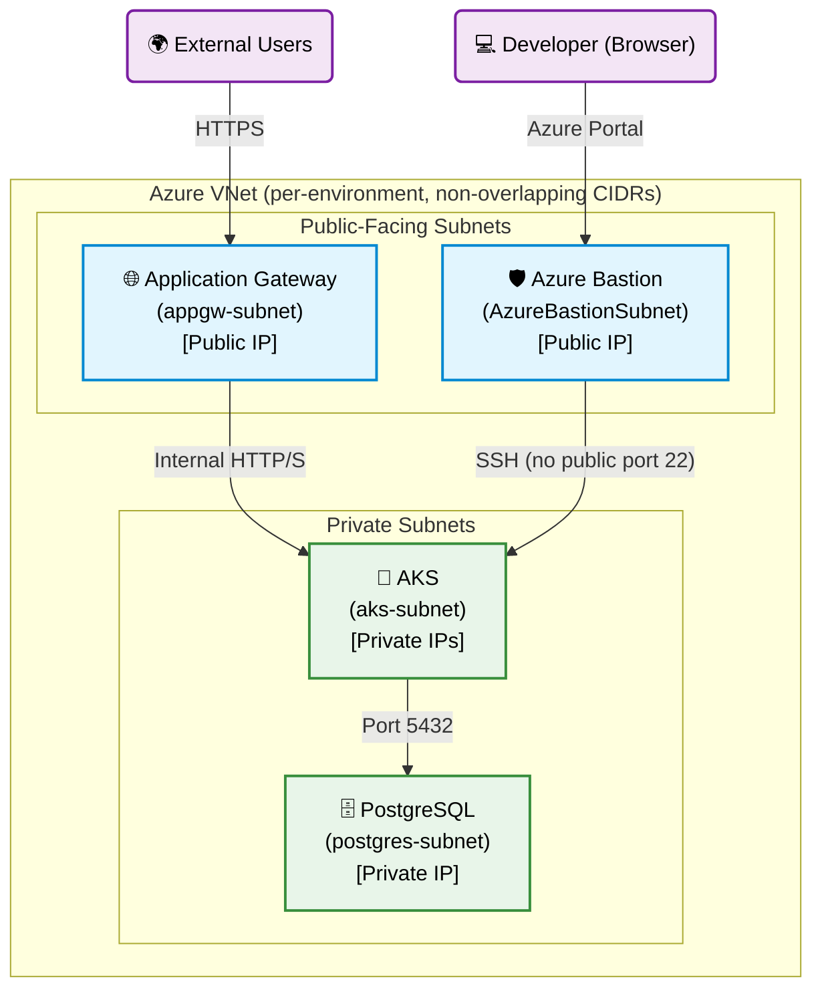
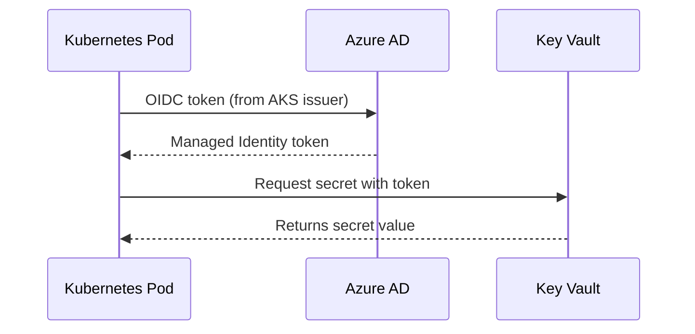

# Boutique Infrastructure

## Architecture Overview

```
boutique-infra/
├── azure/
│   ├── environments/
│   │   ├── shared/      # ACR (non-prod + prod), SonarQube — provisioned FIRST
│   │   ├── dev/         # Development environment
│   │   ├── qa/          # QA environment
│   │   ├── staging/     # Staging / UAT environment
│   │   └── prod/        # Production environment
│   ├── modules/
│   │   ├── resource_group/   # Reusable RG module
│   │   ├── identity/         # Workload identities, RBAC, federated credentials
│   │   ├── acr/              # Azure Container Registry (admin disabled, RBAC only)
│   │   ├── aks/              # Azure Kubernetes Service
│   │   ├── app_gateway/      # Application Gateway (AGIC)
│   │   ├── keyvault/         # Key Vault
│   │   ├── network/          # VNet, subnets, NSGs, Bastion
│   │   ├── postgres/         # PostgreSQL Flexible Server
│   │   └── sonarqube/        # SonarQube VM (SSH via Bastion only)
│   └── templates/
│       ├── terraform-deploy.yml   # Reusable plan + apply template
│       └── terraform-destroy.yml  # Reusable destroy template
├── azure-pipelines-infra.yml      # Main infrastructure pipeline
├── azure-pipelines-destroy.yml    # Destroy pipeline
└── .gitignore
```

## Network Address Plan

| Environment | VNet CIDR      | State Key                  |
|-------------|----------------|----------------------------|
| shared      | 10.0.0.0/16    | shared.terraform.tfstate   |
| dev         | 10.1.0.0/16    | dev2.terraform.tfstate     |
| qa          | 10.3.0.0/16    | qa.terraform.tfstate       |
| staging     | 10.4.0.0/16    | staging.terraform.tfstate  |
| prod        | 10.2.0.0/16    | prod.terraform.tfstate     |

## Container Registry Strategy

| Registry             | SKU      | Used By              | CI Push? |
|----------------------|----------|----------------------|----------|
| `boutiqueacrshared`  | Standard | dev, qa, staging     | ✅ Yes   |
| `boutiqueacrprod`    | Premium  | prod only            | ❌ Never |

Images are **promoted** (not rebuilt) from `boutiqueacrshared` → `boutiqueacrprod` via `az acr import` after staging passes and a manual approval is granted.

## Pipeline Flow

```
shared → dev → qa → staging → [Approve] → Promote Images → [Approve] → prod
```

### Azure DevOps Environments Required

| Environment Name                | Approval Required |
|---------------------------------|-------------------|
| `azure-shared-environment`      | ❌ No             |
| `azure-dev-environment`         | ❌ No             |
| `azure-qa-environment`          | Optional          |
| `azure-staging-environment`     | Optional          |
| `azure-prod-promote-environment`| ✅ Yes            |
| `azure-prod-environment`        | ✅ Yes            |

## Azure DevOps Variable Group

The following secrets must be set in an Azure DevOps Variable Group linked to the pipeline:

| Variable                         | Description                                    | Secret |
|----------------------------------|------------------------------------------------|--------|
| `TF_VAR_db_password`             | PostgreSQL admin password                      | ✅     |
| `TF_VAR_pagerduty_key`           | PagerDuty integration key                      | ✅     |
| `TF_VAR_ssh_public_key`          | SSH public key for SonarQube VM                | ✅     |
| `TF_VAR_cloudinary_cloud_name`   | Cloudinary cloud name                          | ✅     |
| `TF_VAR_cloudinary_api_key`      | Cloudinary API key                             | ✅     |
| `TF_VAR_cloudinary_api_secret`   | Cloudinary API secret                          | ✅     |
| `TF_VAR_google_client_id`        | Google OAuth client ID                         | ✅     |
| `TF_VAR_azure_maps_subscription_key` | Azure Maps key                            | ✅     |
| `TF_VAR_razorpay_key_id`         | Razorpay key ID                                | ✅     |
| `TF_VAR_razorpay_key_secret`     | Razorpay key secret                            | ✅     |
| `TF_VAR_allowed_web_cidrs`       | CIDRs allowed to access SonarQube port 9000    | ❌     |
| `TF_VAR_allowed_ssh_cidrs`       | Direct SSH CIDRs (leave empty, use Bastion)    | ❌     |
| `GITOPS_PAT`                     | Azure DevOps PAT for boutique-gitops repo      | ✅     |
| `IMAGE_TAG`                      | Git commit SHA of the image to promote to prod | ❌     |

## Security Standards

- **ACR admin disabled** — all access via RBAC (AcrPull/AcrPush) with Managed Identities
- **No SSH port 22 open publicly** — use Azure Bastion (already provisioned in every environment's VNet)
- **SonarQube web access** restricted to known CIDRs via `TF_VAR_allowed_web_cidrs`
- **Explicit deny-all NSG rule** on SonarQube at priority 4096
- **Password authentication disabled** on SonarQube VM (`disable_password_authentication = true`)
- **Prod AKS physically cannot pull** from non-prod ACR — RBAC grants AcrPull on `boutiqueacrprod` only
- **Two manual approval gates** before any change reaches prod

## Running from Scratch

### Step 1 — Provision Shared Resources (ACR + SonarQube)
Run the **Boutique Infrastructure Pipeline** with `runShared = true`.
The shared stage runs first. All other environments depend on its completion.

### Step 2 — Provision Environments Sequentially
The pipeline automatically provisions dev → qa → staging. Prod requires two manual approvals.

### Step 3 — GitOps Handoff
After each environment's `Apply` stage, the pipeline automatically:
1. Installs ArgoCD on the AKS cluster
2. Connects ArgoCD to the `boutique-gitops` repo
3. Injects Workload Identity client IDs and Key Vault URLs into the gitops manifests

### Teardown
Run the **Destroy Infrastructure** pipeline. It runs `terraform plan -destroy` first; review the plan, then approve to proceed.

## Network Architecture



## Federated Identity & Secret Management

Pods authenticate to Azure Key Vault using **Workload Identity (OIDC)** — no hardcoded passwords anywhere.


