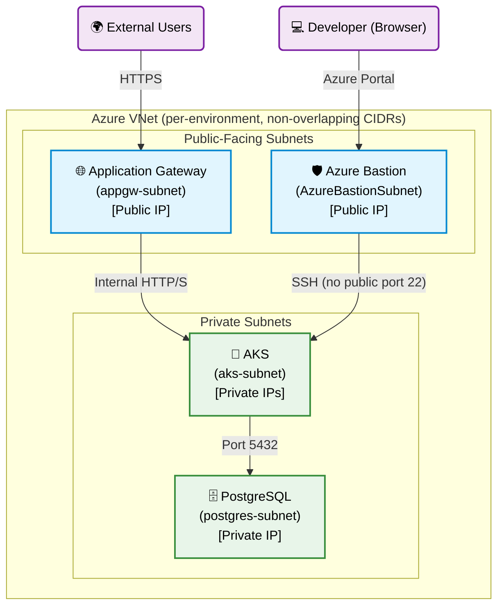
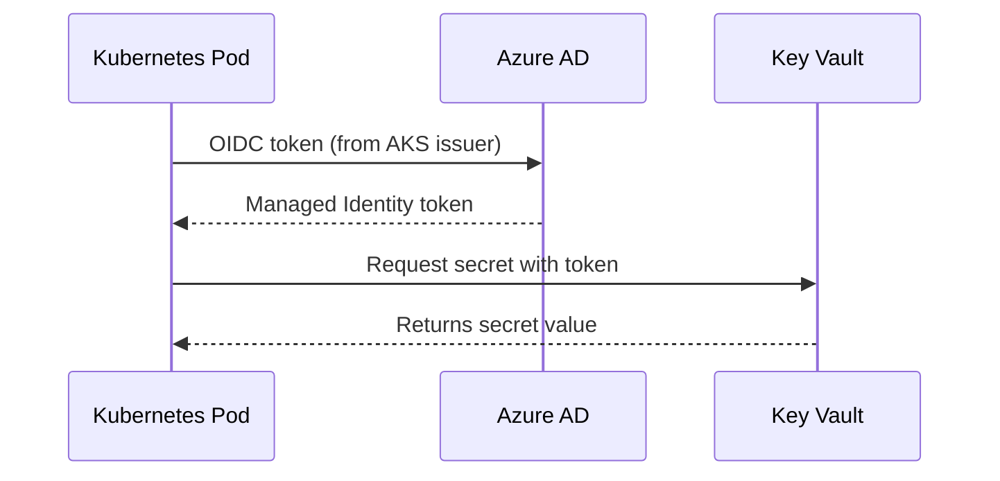

# Boutique Infrastructure

## Architecture Overview

```
boutique-infra/
├── azure/
│   ├── environments/
│   │   ├── dev/         # Development environment
│   │   ├── qa/          # QA environment
│   │   ├── staging/     # Staging / UAT environment
│   │   └── prod/        # Production environment
│   ├── modules/
│   │   ├── resource_group/   # Reusable RG module
│   │   ├── identity/         # Workload identities, RBAC, federated credentials
│   │   ├── acr/              # Azure Container Registry (admin disabled, RBAC only)
│   │   ├── aks/              # Azure Kubernetes Service
│   │   ├── app_gateway/      # Application Gateway (AGIC)
│   │   ├── keyvault/         # Key Vault
│   │   ├── maps/             # Azure Maps account
│   │   ├── network/          # VNet, subnets, NSGs, Bastion
│   │   └── postgres/         # PostgreSQL Flexible Server
│   └── templates/
│       ├── terraform-deploy.yml   # Reusable plan + apply template
│       ├── terraform-destroy.yml  # Reusable destroy template
│       └── platform-deploy.yml    # Reusable platform add-ons template
├── platform/                      # Cluster add-ons: versions, values, manifests, deploy.sh
├── azure-pipelines-infra.yml      # Infrastructure pipeline (Terraform)
├── azure-pipelines-platform.yml   # Platform pipeline (Helm add-ons)
├── azure-pipelines-destroy.yml    # Destroy pipeline
└── .gitignore
```

## Network Address Plan

| Environment | VNet CIDR      | State Key                  |
|-------------|----------------|----------------------------|
| dev         | 10.1.0.0/16    | dev2.terraform.tfstate     |
| qa          | 10.3.0.0/16    | qa.terraform.tfstate       |
| staging     | 10.4.0.0/16    | staging.terraform.tfstate  |
| prod        | 10.2.0.0/16    | prod.terraform.tfstate     |

## Container Registry Strategy

Each environment has its own ACR, created by its Terraform (`module "acr"`), and its AKS
kubelet identity has `AcrPull` on that registry only. The registry names come from the
`acr-registries` variable group (`devAcr`, `qaAcr`, `stagingAcr`, `prodAcr`).

CI currently pushes to the dev ACR only. Moving an image to a higher environment is part of
that environment's app Release pipeline (`az acr import` of the already-tested tag — images
are promoted, never rebuilt), not of the infrastructure pipeline.

## Pipelines

```
infra pipeline      Plan → Apply (per env)                 azure-pipelines-infra.yml
platform pipeline   Validate → Deploy Platform (per env)   azure-pipelines-platform.yml
app CI              CodeQuality → Test → BuildAndScan      boutique-app/azure-pipelines.yml
app Release         helm upgrade --install (per env)       Azure DevOps Releases
destroy pipeline    Plan Destroy → Destroy (per env)       azure-pipelines-destroy.yml
```

### Azure DevOps Environments Required

| Environment Name                | Approval Required |
|---------------------------------|-------------------|
| `azure-dev-environment`         | ❌ No             |
| `azure-qa-environment`          | Optional          |
| `azure-staging-environment`     | Optional          |
| `azure-prod-environment`        | ✅ Yes            |

## Azure DevOps Variable Group

The following secrets must be set in an Azure DevOps Variable Group linked to the pipeline:

| Variable                         | Description                                    | Secret |
|----------------------------------|------------------------------------------------|--------|
| `TF_VAR_db_password`             | PostgreSQL admin password                      | ✅     |
| `TF_VAR_pagerduty_key`           | PagerDuty integration key                      | ✅     |
| `TF_VAR_ssh_public_key`          | SSH public key for AKS nodes                   | ✅     |
| `TF_VAR_cloudinary_cloud_name`   | Cloudinary cloud name                          | ✅     |
| `TF_VAR_cloudinary_api_key`      | Cloudinary API key                             | ✅     |
| `TF_VAR_cloudinary_api_secret`   | Cloudinary API secret                          | ✅     |
| `TF_VAR_google_client_id`        | Google OAuth client ID                         | ✅     |
| `TF_VAR_azure_maps_subscription_key` | Azure Maps key                            | ✅     |
| `TF_VAR_razorpay_key_id`         | Razorpay key ID                                | ✅     |
| `TF_VAR_razorpay_key_secret`     | Razorpay key secret                            | ✅     |

## Security Standards

- **ACR admin disabled** — all access via RBAC (AcrPull/AcrPush) with Managed Identities
- **No SSH port 22 open publicly** — use Azure Bastion (already provisioned in every environment's VNet)
- **Prod AKS physically cannot pull** from non-prod ACR — RBAC grants AcrPull on `boutiqueacrprod9p2x4` only
- **Two manual approval gates** before any change reaches prod

## Running from Scratch

### Step 1 — Infrastructure
Run the **infra pipeline**. By default it plans and applies **dev** only; approve the Apply
stage in the `azure-dev-environment` environment.

### Step 2 — Environments beyond dev
Tick `runQa`, `runStaging` or `runProd` at queue time. Each environment waits for the previous
one when both are in the same run.

### Selective Runs
When you only changed one environment's infra (e.g. `qa`), you don't need to re-run everything before it. Queue the pipeline manually and set the `run*` parameters to skip environments you haven't touched:

| Parameter        | Controls                          |
|-------------------|------------------------------------|
| `runDev`          | Plan/Apply `dev`                  |
| `runQa`           | Plan/Apply `qa`                   |
| `runStaging`      | Plan/Apply `staging`              |
| `runProd`         | Plan/Apply `prod`                 |

Each stage only depends on the previous one if that previous stage is included in the same run — e.g. set `runDev=false, runQa=true` to apply `qa` on its own. Only `runDev` defaults to `true`; QA, Staging and Prod are opt-in at queue time until those environments are needed. The platform and destroy pipelines follow the same rule (platform: dev only; destroy: nothing by default).

### Step 3 — Platform Add-ons
Run the **Platform pipeline** (`azure-pipelines-platform.yml`) for the environment. It reads the
environment's Terraform outputs (Key Vault URL, workload identity client IDs) and runs
`platform/scripts/deploy.sh`, which installs, in order:

1. **external-secrets** + the `azure-store` `ClusterSecretStore` (Key Vault via workload identity)
2. **cert-manager** + the `letsencrypt-staging` / `letsencrypt-prod` `ClusterIssuer`s
3. **reflector** + the `edge-tls` `Certificate` for the environment's hostname, reflected into
   `boutique-app` and `monitoring`
4. **kube-prometheus-stack**, after its `grafana-admin-secret` and `pagerduty-secret` ExternalSecrets are synced

#### Public endpoints and TLS

Each environment has one stable hostname, `<prefix>-boutique.<region>.cloudapp.azure.com`
(`terraform output app_gateway_fqdn`), served by App Gateway through AGIC:

| URL | Backend | Exposure |
|---|---|---|
| `https://<host>/` and `/api` | boutique frontend / gateway | public |
| `https://<host>/grafana` | Grafana (admin login from Key Vault) | public, login required |
| Prometheus, Alertmanager | ClusterIP only | `kubectl port-forward` |

- **One certificate per environment.** `edge-tls` is issued once by cert-manager (HTTP-01 via AGIC)
  and copied by reflector into every namespace with an Ingress on that host, so a rebuild costs
  one Let's Encrypt issuance (limit: 5 per week for the same hostname). Renewal is automatic.
- **HTTP→HTTPS redirect happens in the frontend's nginx** (`X-Forwarded-Proto` + HSTS), not with
  AGIC's `ssl-redirect`, which would also redirect the HTTP-01 challenge and break renewals.
- **AGIC owns App Gateway's routing config.** The `app_gateway` module ignores changes to
  listeners, rules, pools, probes and certificates so `terraform apply` does not undo AGIC.
- With a real domain, the standard upgrade is an Azure DNS zone plus DNS-01 validation (cert-manager
  already has a workload identity for it), a wildcard certificate, and a separate `grafana.<domain>`.

Chart versions are pinned in `platform/versions.env`; values live in `platform/values/<chart>/values.yaml`
(add `values-<env>.yaml` next to it for per-environment overrides). The pipeline also runs on changes
under `platform/**`. To run it by hand against the current kubectl context:

```bash
TENANT_ID=... KV_URL=... ESO_CLIENT_ID=... CERT_MANAGER_CLIENT_ID=... ACME_EMAIL=... \
  platform/scripts/deploy.sh dev
platform/scripts/deploy.sh dev --template   # render only, no cluster needed
```

### Step 4 — Application
Run the app's Release pipeline. The app chart needs the CRDs, `ClusterSecretStore` and
`ClusterIssuer`s from Step 3, so Step 3 must have completed first.

### Teardown
Run the **Destroy Infrastructure** pipeline. It runs `terraform plan -destroy` first; review the plan, then approve to proceed.

## Network Architecture



## Federated Identity & Secret Management

Pods authenticate to Azure Key Vault using **Workload Identity (OIDC)** — no hardcoded passwords anywhere.


